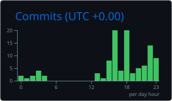

```console
$ ssh guest@0jre.dev
Welcome to 0jre's machine — Ubuntu 24.04 LTS (GNU/Linux)
Last login: never. He's always here.

guest@0jre:~$ whoami
jre — builder, Brasil.

guest@0jre:~$ cat /etc/motd
:|

guest@0jre:~$ cat ~/.config/stack
langs:      TypeScript · Python · Rust · Go
agents:     MCP · multi-agent orchestration · LLM tooling
infra:      AWS · Docker · Linux · Windows

guest@0jre:~$ stats --github
commits: yes

guest@0jre:~$ contact
mail:  ojulio.re@gmail.com
gh:    github.com/0jre

guest@0jre:~$ exit
Connection to 0jre.dev closed.
```

```console
$ ssh stats@github.com -p 443
Connected to github.com — fetching metrics for 0jre...
```

<div align="center">
  
</div>

<div align="center">
  
</div>
